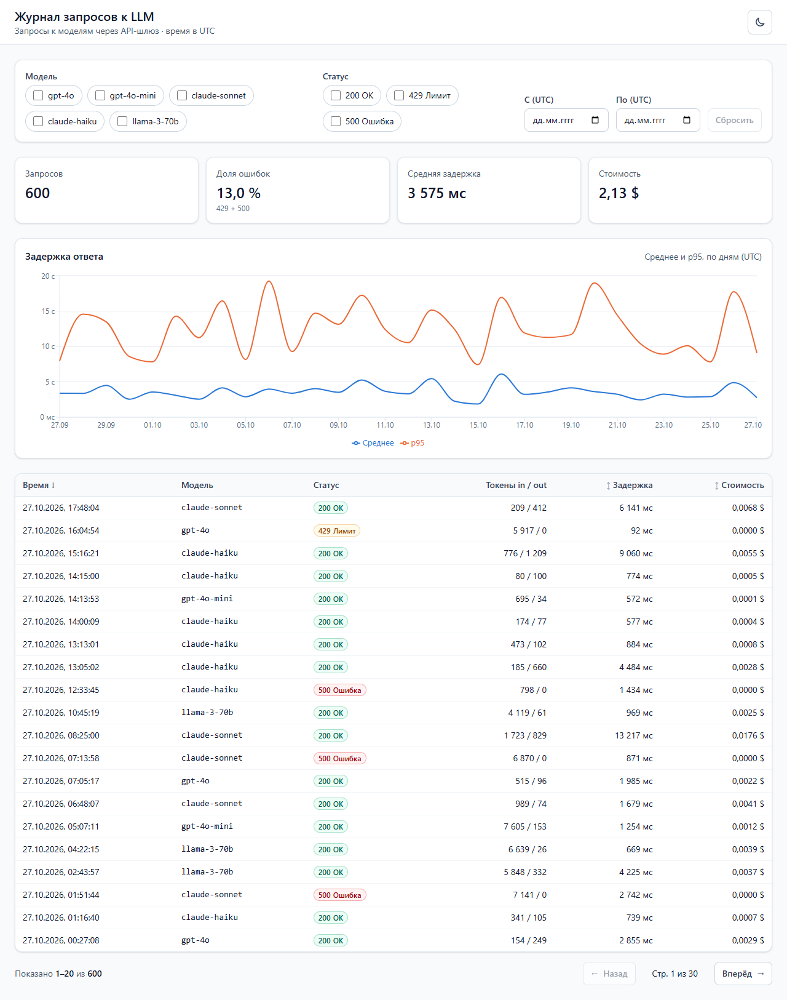
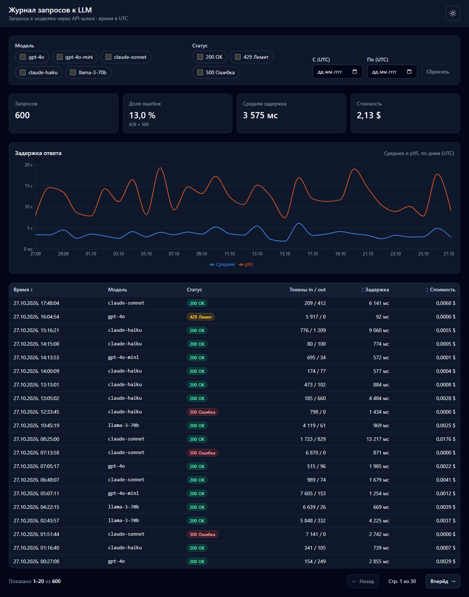
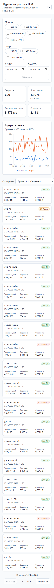
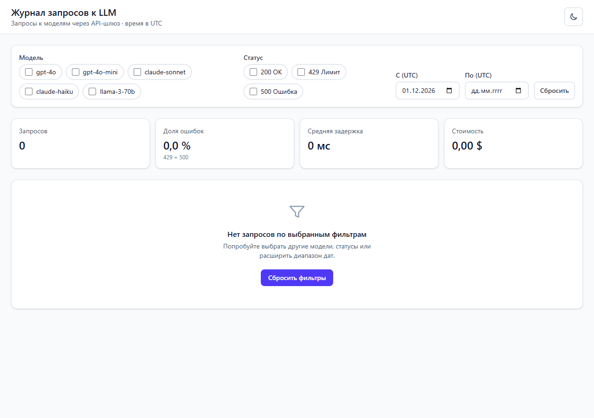
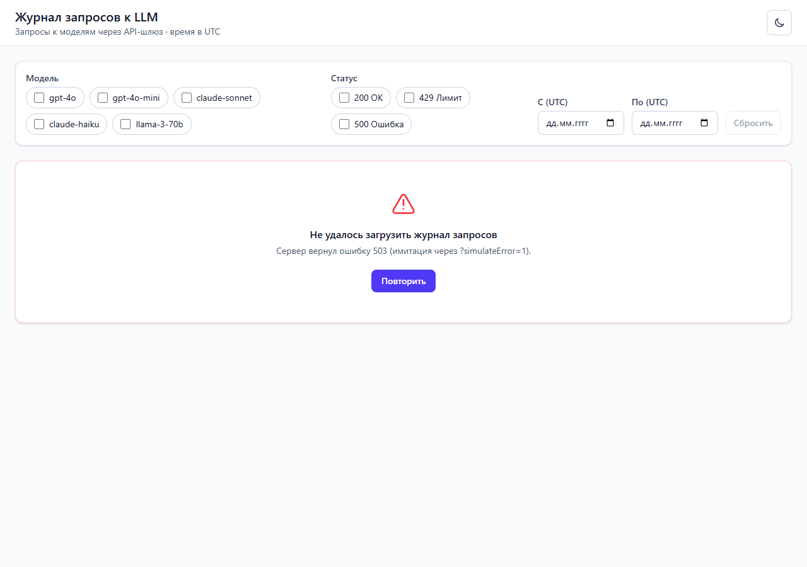

# Журнал запросов к LLM

Дашборд для админ-панели API-шлюза: какие запросы к моделям сделал клиент, сколько они стоили
и как быстро ответили модели.

**Стек:** React 18 · TypeScript (strict) · Vite · TanStack Query v5 · React Router v6 · Recharts ·
Tailwind CSS v4 · zod · Vitest + Testing Library

**Демо:** https://llm-request-log-dashboard.vercel.app/

## Скриншоты

| Светлая тема                       | Тёмная тема                      |
| ---------------------------------- | -------------------------------- |
|  |  |

| Мобильная, 360 px                       | Пустое состояние               | Ошибка                    |
| --------------------------------------- | ------------------------------ | ------------------------- |
|  |  |  |

## Быстрый старт

```bash
npm i
npm run generate   # создаёт public/data/requests.json (600 записей, всегда одинаковых)
npm run dev        # http://localhost:5173
```

| Команда             | Что делает                                   |
| ------------------- | -------------------------------------------- |
| `npm run dev`       | dev-сервер                                   |
| `npm run build`     | проверка типов + production-сборка в `dist/` |
| `npm run preview`   | локальный просмотр собранной версии          |
| `npm run generate`  | генерация демо-данных                        |
| `npm test`          | тесты (Vitest)                               |
| `npm run lint`      | ESLint (`no-explicit-any: error`)            |
| `npm run typecheck` | `tsc --noEmit`                               |
| `npm run format`    | Prettier                                     |

## Формат URL

Всё состояние страницы хранится в адресной строке, поэтому ссылкой можно поделиться,
а перезагрузка и кнопки «назад/вперёд» работают как ожидается.

```
?model=gpt-4o,claude-haiku&status=429,500&from=2026-10-01&to=2026-10-15&sort=latencyMs:desc&page=2
```

| Параметр        | Значения                                                                                       | По умолчанию     |
| --------------- | ---------------------------------------------------------------------------------------------- | ---------------- |
| `model`         | через запятую: `gpt-4o`, `gpt-4o-mini`, `claude-sonnet`, `claude-haiku`, `llama-3-70b`         | все модели       |
| `status`        | через запятую: `200`, `429`, `500`                                                             | все статусы      |
| `from` / `to`   | `YYYY-MM-DD` (UTC), обе границы включительно; `to` — весь день                                 | без ограничений  |
| `sort`          | `поле:направление`, поле — `timestamp` / `latencyMs` / `costUsd`, направление — `asc` / `desc` | `timestamp:desc` |
| `page`          | целое ≥ 1; больше максимума → последняя страница                                               | `1`              |
| `simulateError` | `1` — имитировать ошибку сервера                                                               | —                |

- Значения по умолчанию в URL не пишутся: ссылка остаётся короткой.
- Некорректные значения (`model=gpt-9`, `page=-1`, `from=2026-02-30`) молча отбрасываются.
- При смене фильтра или сортировки `page` сбрасывается на 1.
- Все даты и время — в **UTC**: так фильтр по ссылке даёт один и тот же результат в любом часовом поясе.

## Как показать состояние ошибки

Откройте `/?simulateError=1`. `fetchRequests()` бросит ошибку, TanStack Query сделает одну
повторную попытку (`retry: 1`) и покажет сообщение с кнопкой «Повторить».

Если в `requests.json` попадут неверные данные, их отловит zod-схема, и пользователь тоже увидит
состояние ошибки.

Пустое состояние можно увидеть, например, так: `/?from=2026-12-01`.

## Архитектура

```
src/
  api/        загрузка данных (fetch + имитация задержки) и zod-схема
  lib/        чистые функции: фильтры, сортировка, пагинация, итоги, график, URL, форматирование
  hooks/      useRequests (TanStack Query), useUrlFilters (URL ↔ состояние), useTheme
  components/ компоненты интерфейса
scripts/      генератор демо-данных
```

Данные проходят через конвейер чистых функций:

```
requests ─► filterRequests ─► sortRequests ─► paginate ─► таблица
                  │
                  ├─► summarize ─► карточки итогов
                  └─► buildLatencySeries ─► график
```

**Почему логика вынесена в чистые функции.** Чистая функция зависит только от аргументов
и ничего не меняет снаружи. Поэтому:

- её легко тестировать: не нужен React, браузер или моки, достаточно `expect(f(x)).toEqual(y)`;
- компоненты остаются простыми: они только показывают данные и передают события наверх;
- логику легко перенести на сервер (например, при переходе на серверную пагинацию).

**Типизация.** В коде нет ни одного `any`. Тип `LlmRequest` выводится из zod-схемы через
`z.infer`, поэтому тип и проверка в рантайме не могут разойтись. Списки моделей и статусов
объявлены один раз как `as const`-массивы, и из них получаются union-типы.

**Тема.** По умолчанию берётся системная тема (`prefers-color-scheme`). После переключения
выбор сохраняется в `localStorage`. Небольшой скрипт в `index.html` ставит класс `dark`
ещё до запуска React, поэтому светлая тема не «мигает» при загрузке.

**Адаптивность.** На ширине от 768 px показывается таблица, на узких экранах — карточки
и сортировка через `<select>`. Вёрстка проверена на 360 px: горизонтального скролла нет.

**Данные.** `scripts/generate-data.ts` использует ГПСЧ mulberry32 с фиксированным seed
и фиксированной «текущей» датой (27.10.2026). Каждый запуск даёт байт-в-байт одинаковый файл:
примерно 88 % ответов 200, 8 % — 429, 4 % — 500. Задержка зависит от модели и числа выходных
токенов, есть редкие выбросы. Цены моделей — демо-значения (`MODEL_PRICING` в `src/types.ts`).
Средняя задержка в итогах считается по всем отфильтрованным запросам, включая ошибки.

## Тесты

```bash
npm test
```

- `filters` — одна или несколько моделей, статус, границы дат включительно (весь день «по»), комбинация фильтров, пустой фильтр, пустой результат;
- `summary` — счётчики, доля ошибок, средняя задержка, стоимость, пустой массив без NaN, округление;
- `sorting` — asc/desc по каждому полю, стабильность, клик по заголовку;
- `pagination` — границы, последняя неполная страница, страница больше максимума, пустой список;
- `urlState` — parse ↔ serialize туда-обратно, мусор в URL, сохранение посторонних параметров;
- `chart` — p95, выбор шага (часы/дни), группировка;
- компоненты — пустое состояние и состояние ошибки.

CI (`.github/workflows/ci.yml`) на каждый push запускает lint, typecheck, тесты и сборку.

## Деплой (Vercel)

1. Залейте репозиторий на GitHub.
2. vercel.com → **Add New Project** → выберите репозиторий → Framework: **Vite** → **Deploy**.
3. Вставьте полученную ссылку в начало этого README.

`vercel.json` перенаправляет все пути на `index.html`. Файл `public/data/requests.json`
закоммичен, поэтому отдельный шаг генерации при деплое не нужен.

## Что улучшил бы дальше

- **Серверная фильтрация и пагинация.** Сейчас на клиент загружаются все 600 записей. Для реального журнала с миллионами строк фильтры и `page` уходили бы в API, а ключ запроса в TanStack Query включал бы фильтры (`['requests', filters]`, с `placeholderData: keepPreviousData`).
- **Виртуализация таблицы** (`@tanstack/react-virtual`), если понадобится показывать тысячи строк без пагинации.
- Агрегация для графика на сервере.
- Выбор часового пояса (сейчас всё в UTC).
- Фильтр по диапазону стоимости и задержки, поиск по `id`.
- Экспорт выборки в CSV.
- E2E-тесты на Playwright в CI.
